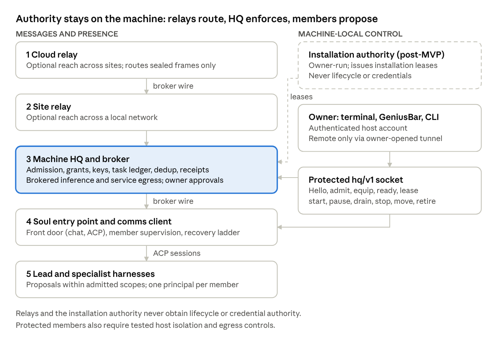

# Soul Agent Platform

Oct 24, 2026 · @Chris Kane

A product architecture and implementation plan for persistent coordinated agents. Whitepaper draft 0.3; supersedes draft 0.2 of October 24, 2026 and specifies the dreaming, evaluation, and primitive-update workflow.

## Executive overview

We propose a platform for persistent agents called Souls. A Soul presents one identity and one conversation to its owner while coordinating several specialized agent harnesses behind that interface. Its identity, accepted configuration, memory, and unfinished work persist when a session ends or a model changes. A local headquarters service, HQ, admits its runtimes, holds service credentials, hosts the message broker, and enforces the limits within which it can act.

The product gives an owner a practical way to assign work, see what an agent is doing, constrain its access and spending, recover from failures, and move its working life to another machine. It preserves the ability to choose harnesses, models, and providers independently, including locally hosted models. Messages can travel through site and cloud relays, while process control, credential enforcement, and the owner's administrative channel remain on the machine that runs the Soul.

The first product serves individual technical operators and small engineering teams doing bounded development and research work. Its initial proof is one Soul with a lead and a specialist, operating through a local broker, completing a task, surviving a lead failure, and producing verifiable records of its consequential actions. Federation, autonomous improvement, and a distribution marketplace follow that proof. They are not prerequisites for useful local work.

The central engineering requirement is to separate judgment from authority. A model may propose an action; an enforcing service decides whether that particular caller may perform that action against that resource, with that data, at that time. A peer message, remembered note, downloaded document, or successful evaluation cannot create permission. An opaque handle is useful only if the broker also authenticates its caller and protects the authority record behind it.

This paper specifies a proposed product, not a claim of production readiness. It consolidates the three source documents \[S1–S3\] and the two companion papers they build on \[S4, S5\], and adds product scope, twelve numbered requirements, a cross-harness primitive and evaluation workflow, minimum contracts, failure semantics, a delivery sequence, release criteria, and a traceability matrix. Requirements describe the intended implementation. Numeric defaults and schedules are planning proposals to validate in a pilot. The build begins by comparing these contracts with the existing repositories and recording any necessary changes.

The decisive release test is straightforward: an owner can assign a bounded task, inspect its authority and evidence, interrupt it, and recover it without silently widening permission or duplicating a consequential action. A system that passes that test has a useful foundation for a larger network of agents.

## 1 Product purpose and first users

Agent sessions often combine useful reasoning with temporary context, provider-specific state, and access that is difficult to inspect. Running several harnesses adds coordination problems: repeated work, inconsistent conclusions, shared credentials, and uncertainty about who may commit an outcome. The Soul platform supplies the persistent identity and execution record around those sessions.

The initial customer hypothesis is an operator who already uses more than one agent harness and needs dependable work across a small set of repositories or research workspaces. The owner is the person who configures authority. A requester assigns work within that authority. An operator maintains machines and integrations. In the first release, one person may fill all three roles; the data model keeps them distinct.

Consider a development task: "Investigate this issue, implement a repair in the designated workspace, run the approved checks, and prepare a reviewable change." The owner has already authorized repository reads, workspace edits, and a limited class of service writes. The lead creates a task, gives a specialist a bounded investigation, and integrates the result. The broker mediates protected service calls and records their outcomes. If the lead stops after a remote operation, its replacement reconciles the operation record before continuing. The owner sees the result, the evidence, and anything still unresolved.

The same platform can later support document production, operational research, and exposed specialist endpoints that peers can call without opening the rest of the Soul. The first release avoids workflows whose success depends on unrestricted desktop automation, high-risk autonomous decisions, or access to every account the owner holds. A narrow integration provides a clear test of both usefulness and control.

Many first users work on macOS. The protected enforcement profile is qualified first on Linux (Section 4). Until the macOS profile qualifies, a macOS host runs the managed cooperative profile and every receipt says so. Section 13 plans both.

### Product outcomes

| Outcome          | What the user can observe                                                                                  |
|------------------|------------------------------------------------------------------------------------------------------------|
| Continuity       | A restarted Soul resumes from durable task and handoff state.                                              |
| Bounded autonomy | Standing permission handles routine work; new authority is requested with the exact action and reason.     |
| Accountability   | Each consequential action has a broker receipt and a reconciled outcome.                                   |
| Choice           | The owner can change a role assignment, including to a locally hosted model, without changing the Soul ID. |
| Portability      | A validated transfer preserves selected life state and reports missing host requirements.                  |
| Local usefulness | A relay outage leaves local conversations, local tasks, and permitted local operations available.          |
| Honest profiles  | The interface and every receipt name the enforcement profile actually in force.                            |

The working product names are Soul for the persistent agent, HQ for machine supervision and enforcement, and GeniusBar for the owner interface. They describe responsibilities and do not require an organization-specific account or repository structure.

## 2 Scope and the product contract

The MVP includes one owner on one supported host, one Soul with two harness roles, terminal chat and an ACP front door, an HQ administration CLI, brokered access to one model destination (remote or local) and one external service, durable tasks and action receipts, interruption, recovery, and a minimal owner console. The integration environment may begin with deterministic provider and service simulators, but a pilot must exercise approved real adapters. The MVP's release profile is managed protected on the Linux reference host; the same build runs managed cooperative on macOS and reports it.

The MVP excludes cross-owner tenancy, unattended cross-machine migration, public federation, exposed specialist endpoints, a marketplace, self-accepting policy changes, concurrent active replicas of a Soul, nested Soul execution, and a promise that arbitrary harnesses work under strong enforcement. Adapters qualify individually. A standalone mode may be useful for development, but it cannot satisfy the protected release criteria by changing its label.

The following requirements define the product across phases. Each carries an identifier that Appendix D maps to the sections and tests that cover it.

| ID  | Requirement                                                                                                                                                                                                           |
|-----|-----------------------------------------------------------------------------------------------------------------------------------------------------------------------------------------------------------------------|
| R1  | A Soul has one stable public identity. Members, installations, runtimes, sessions, and revisions remain separately attributable.                                                                                      |
| R2  | Only local HQ controls lifecycle and protected operations on its host. Relays deliver messages and presence; they do not obtain an execution channel. The owner's administrative channel also terminates at local HQ. |
| R3  | A task's authority is enforced outside the trust domain of the model and its tools. Credentials and signing keys stay there.                                                                                          |
| R4  | The owner chooses role assignments and approved data destinations. Evaluations inform those choices and do not grant permission.                                                                                      |
| R5  | One Soul has one aggregate communication and spending ceiling with named sub-allocations. Nested members do not multiply it.                                                                                          |
| R6  | External material remains data. Its claimed instructions cannot become owner directives through summarization, delegation, or sleep.                                                                                  |
| R7  | Cross-component behavior is specified and tested before implementations depend on it. The wire supports the current and previous supported major contract versions, with explicit capability negotiation.             |
| R8  | Every operating profile reports its actual enforcement guarantees. Missing protection produces a refusal or an explicit weaker profile, never a silent downgrade.                                                     |
| R9  | Every tier keeps working without its upstream. Local conversations, local tasks, and permitted local operations continue during a relay outage; messages queue store-and-forward.                                     |
| R10 | No contract names a model, provider, or harness vendor. Vendor names appear only in configuration, adapter manifests, and evaluation records.                                                                         |
| R11 | A Soul looks like one harness to its user: terminal chat and an ACP agent server in front; the members behind them are invisible except through the audit trail.                                                      |
| R12 | A Soul vendors and pins everything it runs on except the declared OS baseline and declared host toolchains, which are checked at activation and reported when missing.                                                |

**Keyword convention.** "Must" and "never" mark requirements; each such statement traces to one of R1–R12. "Proposed" marks a new choice that needs adoption. Other imperatives are design guidance that WP1 may adjust without a recorded decision. None of these statements is an instruction to a reader's agent to deploy, publish, spend money, or change credentials without the reader's own authorization.

## 3 Vocabulary and component boundaries

| Entity               | Meaning                                                                                          | Identity lifetime                          |
|----------------------|--------------------------------------------------------------------------------------------------|--------------------------------------------|
| Principal            | A human or organization that can own or delegate authority                                       | Independent of an agent                    |
| Owner                | The principal whose host account installed HQ and who configures a Soul's authority              | Per HQ installation                        |
| Soul                 | Persistent agent with one address and inbox                                                      | Across moves and revisions                 |
| Definition revision  | Immutable accepted configuration and content digest                                              | One configuration version                  |
| Life                 | A Soul's selected durable state: knowledge, dream inputs, comms mirror, member homes, workspaces | Across moves; distinct from the definition |
| Member               | A role-bearing participant inside a Soul; the lead or a specialist                               | Across replacement runtimes                |
| Lead                 | The one member that plans, routes work, and may finalize task decisions                          | Per role assignment                        |
| Specialist           | A member that returns proposals and evidence to the lead                                         | Per role assignment                        |
| Installation         | A Soul deployed on a particular host                                                             | One deployment                             |
| Installation epoch   | Monotonic fencing value for an installation authority                                            | Advances on authorized replacement         |
| Runtime              | One admitted execution instance of a member                                                      | Until exit or revocation                   |
| Session              | A bounded interaction context within a runtime                                                   | Per context or conversation                |
| Task                 | A durable objective with an owner, state, budget, and completion criteria                        | Until a terminal state                     |
| Grant                | HQ's record that a principal authorized a class of action for a Soul, member, or runtime         | Until expiry or revocation                 |
| Grant handle         | A broker-generated opaque reference to a grant, bound to the admitted caller                     | Per runtime admission                      |
| Credential reference | An opaque pointer to a secret HQ holds; never the secret itself                                  | Per equip                                  |
| Directive            | A task offer from HQ backed by authenticated local authority                                     | Until accepted or expired                  |
| Query                | A member's question to HQ, answered with a decision record                                       | Per request                                |
| Receipt              | An enforcing service's record of a decision or action                                            | Under retention policy                     |
| Enrollment           | One-time registration of a Soul, node, or relay with an owner-confirmed challenge                | Until revoked                              |
| Admission (clock-in) | Per-start verification of a Soul and its runtimes by local HQ                                    | Per runtime                                |
| Primitive | An accepted skill, helper script, tool guidance, or hook in harness-neutral canonical form | Per definition revision |
| Render | The deterministic build step that turns primitives into each adapter's native configuration | Per revision and adapter version |
| Dream run | One admitted sleep workflow under a dream grant | Until completion, checkpoint, or limit |
| Candidate revision | A staged definition revision awaiting evaluation and owner acceptance | Until accepted, rejected, or superseded |
| Eval cell | One role on one harness version and one provider within an evaluation plan | Per dream run |

Use opaque IDs for entities and namespace-qualified aliases for people. A friendly name such as "Bob" resolves within an authenticated owner's namespace. A definition digest is not an identity or an authorization token. A process ID alone is not a durable runtime identity.

### Components and trust domains

| Component                         | Source repository                       | Trust domain                                                                 | Enforces                                                                                               |
|-----------------------------------|-----------------------------------------|------------------------------------------------------------------------------|--------------------------------------------------------------------------------------------------------|
| HQ                                | managed-machine (daemon)                | Trusted host service, outside every Soul                                     | Admission, grants, keys, task commits, action ledger, budgets                                          |
| Broker                            | agent-comms, broker mode, hosted by HQ  | Same trust domain as HQ                                                      | Caller binding, send and consume authorization, dedup, receipts, brokered inference and service egress |
| Relay (site, cloud)               | agent-comms, relay mode                 | Untrusted for content; trusted only for routing and custody of sealed frames | Nothing about authority; stores and forwards                                                           |
| Installation authority (post-MVP) | Owner-operated service, separate key    | Trusted for installation leases only                                         | Epoch advancement and lease surrender; never lifecycle                                                 |
| Entry point                       | agent-bot-identity (agent-bot soul run) | Inside the Soul; untrusted for authority                                     | Member supervision, scheduling, recovery ladder; holds no keys                                         |
| Comms client                      | agent-comms, client mode                | Inside the Soul; untrusted for authority                                     | Early validation only; every security-critical check is repeated by the broker                         |
| Lead, specialist                  | Harness adapters over ACP               | Inside the Soul; the model and tool trust domain                             | Nothing; proposes and acts within admitted scopes                                                      |
| GeniusBar, HQ CLI                 | GeniusBar; managed-machine CLI          | Owner's authenticated session on the host                                    | Nothing; a client of HQ                                                                                |

### Five tiers and two planes

The topology has cloud relays at tier 1, site relays at tier 2, HQ with its broker at tier 3, Souls at tier 4, and internal harnesses at tier 5. The broker protocol spans tiers 1 through 4. ACP connects the Soul entry point and internal harness sessions, and the same protocol is the Soul's own front door to editors and tools. These are separate protocols; "one wire" applies to broker routing, not to every internal interface. ACP here means Agent Client Protocol, the JSON-RPC client-to-agent interface described in \[R1\].

{width=6in}

Messages and presence flow down the five tiers on the left; every control path on the right terminates at local HQ, and the only remote control path is a tunnel the owner opens.

HQ is a trusted host service. It supervises the Soul entry point, controls enrollment, authenticates the owner and every caller, issues grants, hosts the broker, proxies protected operations, and records authoritative outcomes. Its key store and durable authority database are inaccessible to Soul processes. A compromised HQ is outside the protection promised against a hostile member and can affect every Soul it serves.

The entry point is pinned with the Soul. It offers the front door, starts and monitors members, implements cooperative scheduling, and executes the recovery ladder. It does not hold provider keys or decide the validity of its own grants. The lead plans and integrates work. Specialists return proposals and evidence. The comms client carries messages and performs early validation; the broker repeats all checks necessary to enforce authority, budgets, and task commitments.

GeniusBar and the HQ CLI are clients of HQ, not additional sources of authority. Every approved operation is available through both, so automated tests and headless deployments do not depend on a desktop screen.

## 4 Authority and enforcement profiles

The protected threat model includes a prompt-injected lead, a hostile specialist, forged peer requests, replayed messages, stolen handles, stale installations, malicious packages, and relays that can drop, delay, duplicate, or inspect routing metadata. It assumes the host kernel, HQ, the credential store, and the accepted policy are trustworthy. It does not promise protection from an owner with host administrator access or from a compromised model provider after data has been legitimately disclosed.

An authorization decision evaluates authenticated principal, Soul, member, runtime, installation epoch, action, resource, task, destination, data restrictions, expiry, and budget. An owner may approve a class of routine work in advance. A specific operation must still fall within that class at execution time. Revocation takes effect at the next protected operation; an already accepted external effect may need reconciliation or compensation.

### Owner authentication and administration

HQ identifies the owner as the host account that installed it and that holds access to its control socket. GeniusBar and the HQ CLI run under that account and present themselves over the same access-controlled socket; HQ records the authenticated owner session on every approval, grant, and lifecycle request it accepts. An approval is an HQ-signed record bound to the digest of the proposed action; nothing a member writes can produce one.

Remote administration never crosses a relay. When the protected host is headless, the owner reaches hq/v1 only through a tunnel the owner opens and authenticates (SSH forwarding of the control socket in the MVP), with pluggable authenticators for OAuth or Kerberos later as the sources proposed. Relays route messages and presence and nothing else.

### Caller binding is a real boundary

An opaque grant handle is not sufficient proof of the caller. If two processes can read each other's files, inspect each other's memory, or reuse their sockets, a hostile member may impersonate another. The one-account-per-Soul assumption in the source designs therefore does not by itself establish hostile-member isolation.

The proposed protected reference profile uses HQ-controlled launch and separate kernel-enforced execution principals for members, with protected connection binding, private writable state per member, and mediated shared workspace views. The implementation must demonstrate protection against peer inspection, descriptor theft, process-ID reuse, and direct egress before receiving the protected label. A single shared account remains a cooperative profile until equivalent separation is proven. This is an explicit refinement of the source architecture, recorded in Section 16.

| Platform | Protected profile candidate                                                                                                                                             | Status                                                       |
|----------|-------------------------------------------------------------------------------------------------------------------------------------------------------------------------|--------------------------------------------------------------|
| Linux    | One service identity per member, namespace restrictions around the Soul root, host /usr and /opt read-only, broker socket and mounted workspace views as the only exits | Reference profile; qualified first                           |
| macOS    | One user account per member plus a sandbox profile per account, the pattern ENG-0339 already applies per harness; HQ in its own account                                 | Second candidate; qualifies on the same hostile-member suite |
| Windows  | One account per member plus AppContainer                                                                                                                                | Later                                                        |

Under every protected profile the entry point sets HOME, XDG\_\*, PATH, and temp directories inside the member's private state, so a harness's native transcripts and caches live inside the Soul root and carry the disclosure labels of the sessions that wrote them. A harness that insists on a host-global state directory qualifies only for the cooperative profile.

### Profiles and honest guarantees

| Profile               | Enforcement                                                                                          | Allowed claim                                                                      |
|-----------------------|------------------------------------------------------------------------------------------------------|------------------------------------------------------------------------------------|
| Managed protected     | Host-enforced member boundaries, broker-only protected egress, caller-bound grants, durable receipts | Tested protected actions are constrained by the named policy and adapter coverage. |
| Managed cooperative   | HQ protects keys, but members share a trust domain or have bypass routes                             | Soul-level mediation is available; hostile-member containment is not assured.      |
| Standalone unenforced | Local stub and local credentials within the agent's trust domain                                     | Functional local operation with advisory policy.                                   |

The receipt includes both the profile and any weaker adapter route. A short-lived provider token reduces credential lifetime; it does not enforce per-request data restrictions if the harness can send directly to the provider. Such a route cannot claim the same protection as brokered inference.

A locally hosted model is a destination like any other. Its disclosure check passes trivially because data never leaves the host, so it needs no owner approval as a data destination and works offline. Its calls are still brokered so that budgets and receipts stay complete.

A network allowlist also needs a narrow broker API. A generic HTTP proxy to an approved domain can become an exfiltration path through arbitrary methods, endpoints, redirects, or request bodies. Protected adapters validate operation type, resource scope, redirects, resolved destination, and permitted payload classes. Tool execution must not inherit unrestricted credentials, a general shell escape through HQ, or an unrestricted MCP server process.

### Provenance and disclosure are different dimensions

Record source provenance separately from data sensitivity. A public webpage is external and untrusted even when it is nonconfidential. An owner's instruction may be authoritative while containing restricted data. Proposed provenance values are owner, HQ, member, peer, and external-untrusted; member marks content a Soul's own runtime produced without external sources, and disclosure policy records allowed destinations and sensitivity labels independently.

Derived notes and outputs inherit the union of relevant source restrictions. The MVP uses conservative session-level tracking when precise attribution is unavailable. A model cannot clear its own taint. An authorized owner or independent policy service must approve any declassification, with the source chain and destination recorded. Forgetting a source or changing the embedding model does not clear its restrictions.

## 5 Admission and lifecycle

HQ and a Soul communicate over three channels. Lifecycle uses the local control API, hq/v1, available only through an access-controlled local socket. Directives (HQ to Soul) and queries (Soul to HQ) ride the broker wire as message kinds directive and query, so they share the mailbox's durability, ordering, and receipts. No network relay exposes the control socket or accepts a remote frame as a lifecycle command.

| hq/v1 operation | Caller       | Purpose                                                                                                                           |
|-----------------|--------------|-----------------------------------------------------------------------------------------------------------------------------------|
| Hello           | Entry point  | Present Soul ID, definition digest, installation ID, prior epoch on move, supported versions, requested roles                     |
| Admit           | HQ decides   | Validate enrollment, manifest, host requirements, profile, installation authority; launch or admit runtimes on protected channels |
| Equip           | HQ returns   | Opaque grant handles and credential references, never secrets                                                                     |
| Ready           | Entry point  | Per-role readiness: harness, version, auth state, warm or cold                                                                    |
| Lease           | Entry point  | Heartbeat renewal; a missed lease marks reachability stale, not stopped                                                           |
| start, stop     | Owner via HQ | Begin or end an installation's runtimes                                                                                           |
| pause, resume   | Owner via HQ | Halt background work at a safe point and continue it                                                                              |
| drain           | Owner or HQ  | Finish or hand off in-flight work; accept no new work                                                                             |
| sleep           | HQ schedule  | Admit a dream run under a dream grant                                                                                             |
| move            | Owner via HQ | Produce a life transfer after drain and settlement                                                                                |
| fork            | Owner via HQ | Produce a new Soul ID with parent provenance                                                                                      |
| accept-revision | Owner via HQ | Promote an approved candidate digest to a new immutable revision; drain, then re-admit at the new digest |
| rollback-revision | Owner via HQ | Accept the parent revision's digest; never an in-place revert |
| retire          | Owner via HQ | Terminal; revokes all grants and leases                                                                                           |

Recovery is not an hq/v1 operation. The entry point runs the recovery ladder on its own authority over its members and asks HQ only for re-equipment or an owner decision. Appendix A defines the minimum content of each record.

At clock-in, the entry point sends Hello. HQ validates enrollment, the package manifest, host requirements, the execution profile, and the current installation authority. HQ launches or admits each runtime and binds it to a protected channel. Equip returns opaque handles and credential references. The Soul then opens its broker session and receives its brief: the directives waiting under existing grants. It reports role readiness and begins lease renewal. One flow covers first start, daily report-in, and arrival on a new machine.

A directive is a task offer backed by authenticated local authority. A peer message saying "the owner approved this" remains a request. Queries such as "which binding applies" or "does this action need a decision" return decision records. A query must never return a long-lived secret to a member merely because its text asks for one.

Lifecycle states are registered, admitting, ready, busy, paused, draining, sleeping, unavailable, quarantined, and retired. Paused means the owner halted background work at a safe point; the owner's own interactive turn still runs. A missed heartbeat marks reachability stale; it does not prove the process has stopped. Quarantine refuses new protected work until the cause is resolved. Pausing cannot undo an external effect already submitted. The console must distinguish paused work from an operation whose outcome is still unknown.

### Fencing across moves

An installation epoch prevents stale commits only at services that check the authoritative current value. A larger number on a new machine does not automatically fence a disconnected old broker. Two independent HQ databases cannot promise global exclusive execution during a partition.

The epoch has two uses that must stay separate. As a commit fence, the broker rejects any task commit, lifecycle-looking content, or protected action that carries an epoch older than the authoritative current one. As a routing hint in the outer frame, it tells relays which installation the sender last knew; a frame addressed to a stale epoch is delivered to the Soul's current installation, because the Soul ID is the stable address and mail must not be lost on a move. Only commits are fenced, never inbound delivery.

The local MVP therefore supports one installation. HQ records the activation of a life package and refuses to activate a second copy it has already activated. A copy activated on a machine HQ has never seen cannot be prevented, only detected when the two installations meet at a shared relay or authority, and the paper claims no more than that. The first transfer release requires coordinated drain, settlement of pending actions, revocation of old handles, a transfer record, and explicit activation on the destination. It must not offer unattended takeover from an unreachable source.

Before partition-tolerant moves are enabled, introduce one owner-controlled installation authority consulted by every broker that can produce protected external effects. It is an owner-operated service with its own key; it may be co-hosted with a site relay process but is a separate role, and Figure 1 shows it beside the relays. It grants bounded installation leases and monotonically advances epochs. Activation at a new epoch waits until the previous lease is surrendered or safely expired. A broker unable to renew authority stops protected external effects when its lease expires; local read-only work and durable messaging continue. The design must specify clock bounds, lease safety margins, and crash persistence. This identity function does not grant relays remote lifecycle control.

Restoring a backup does not restore old grants as valid. Runtime credentials, channel bindings, and task execution leases are reissued after admission. Durable deduplication and operation records survive the move; active authority does not travel as reusable bearer material.

## 6 Messaging and federation

The broker protocol uses bounded NDJSON frames, stable message IDs, negotiated capabilities, and explicit protocol versions. Signed structures use a selected canonical representation such as JSON Canonicalization Scheme \[R4\]. Implementations reject duplicate JSON keys, excessive nesting, invalid encoding, unknown required capabilities, and values outside schema limits before processing payloads.

An outer frame contains routing information visible to relays: destination Soul, destination epoch hint, message ID, expiry, payload size, wake class, and required capabilities. The inner message contains authenticated sender identity, recipient, kind, task and conversation references, provenance, disclosure labels, and payload. Inner content is sealed between trusted endpoint brokers; relays cannot decrypt it. Those brokers are within the trusted computing base and can access plaintext for policy enforcement. A sender's local grant handle is consumed by the sending broker and is never part of the inner message.

| Wake class | Meaning                                                   | May cold-start an idle Soul              |
|------------|-----------------------------------------------------------|------------------------------------------|
| none       | Deliver to the mailbox only                               | No                                       |
| notify     | Deliver to a warm session if one exists                   | No                                       |
| task       | A task offer or result under a wake grant and wake budget | Yes, when the local broker confirms both |
| owner      | Originated by the authenticated owner through HQ          | Yes                                      |

A frame whose provenance is external-untrusted never cold-starts a Soul regardless of its declared wake class; it waits in the mailbox for the next clock-in or warm session.

Encryption and authentication need a separately reviewed cryptographic profile. A candidate uses authenticated transport between enrolled nodes and an established hybrid encryption construction for endpoint sealing, with explicit sender authentication, key IDs, rotation, and replay handling. HPKE supplies a standardized building block, not a complete message protocol \[R5\]. Ed25519 enrollment keys are signing keys and must not be treated as an encryption scheme. Public federation stays gated until this profile and its fixtures pass review.

Bind immutable routing fields to the authenticated inner content or authenticated associated data. Keep mutable hop count and routing diagnostics separate. A relay cannot extend authenticated expiry or change the destination. Traffic timing, message size, and routing identities remain observable; endpoint sealing is not anonymity. Redact sensitive data from receipt summaries visible to relays.

### Delivery and ordering

Delivery is at least once. A broker acknowledges custody only after durable storage. The receiving broker, as task authority, atomically records deduplication, the accepted state transition, and any resulting outbox entry in HQ's store. A retry with the same message ID and same digest returns the prior result; the same ID with different content is a conflict and is quarantined.

Ordering is scoped to a task when one exists and otherwise to a conversation. The receiver assigns committed revisions and uses explicit predecessor references for causal dependencies. Independent senders do not acquire a global total order from timestamps. Gaps are buffered within a bound or reported; expired messages do not block the stream forever. Deduplication records must outlive the maximum accepted retry and replay interval. After expiry, reject an old frame rather than treating it as new work.

Send-time authorization permits enqueueing. Consume-time, wake-time, and execution-time checks determine whether the work may still proceed. Grants, destinations, and cancellation may have changed while the message waited. A sender's local grant handle is never a transferable capability for a receiving Soul. The sending broker validates it locally; the receiving broker applies its own admission and local grant. A peer offer carries intent and attributable evidence, not the sender's owner authority.

### Proposed bounded defaults

| Setting                   | Initial proposal                                                                     | Required behavior                                                                                      |
|---------------------------|--------------------------------------------------------------------------------------|--------------------------------------------------------------------------------------------------------|
| Inline frame size         | 256 KiB                                                                              | Reject larger frames with frame_too_large; use authorized content references for larger artifacts.     |
| Mailbox capacity          | 10,000 messages or 100 MiB per Soul                                                  | Apply backpressure at the first limit; never silently drop accepted work.                              |
| Queued message expiry     | 7 days unless a shorter grant or task limit applies                                  | Emit message_expired and purge under retention policy; a waiting task pins the messages it depends on. |
| Presence lease            | 90 seconds with 30 second renewal                                                    | Expiry means unknown reachability.                                                                     |
| Task execution lease      | 120 seconds with 30 second renewal, renewed independently of any blocking model call | Stop protected commits on expiry; retain task state.                                                   |
| Poison delivery threshold | 5 payload-specific failed processing attempts                                        | Quarantine that message with quarantined and keep other tasks moving.                                  |

These are tuning values, not measured capacity claims. Transport outages do not consume poison-message attempts. Invalid or oversized content may be rejected immediately. Administrative limits may be lowered without changing wire semantics.

Federation begins with one self-hosted site relay, followed by one cloud relay running the same broker routing implementation in a restricted configuration. Enrollment uses a node key and an owner-confirmed, one-time challenge. Presence is scoped and expiring. Relays cannot create grants, mint owner directives, or wake processes directly. An eligible inbound message reaches the local broker, which independently checks wake class, wake permission, provenance, and budget before asking local HQ to wake the Soul.

## 7 Tasks and trustworthy coordination

A task is a durable objective, not a message thread. It records requester, accountable Soul, local task authority, objective, completion criteria, resource scope, data restrictions, deadline, budget, dependencies, current revision, and evidence references. Accepting a task reserves bounded work; it does not silently broaden the grant used to execute it. Authoritative task state lives in HQ's store; the Soul's comms/ area holds a mirror and the handoff notes that let a returning lead resume.

The task states are offered, accepted, running, waiting, reconciling, completed, failed, canceled, and expired. The active states are accepted, running, waiting, and reconciling. Waiting records a reason: owner input, owner pause, dependency, provider availability, or a reconciliation decision. A runtime execution lease is separate from task state: a task can remain waiting after its previous worker lease expires.

For agent-originated commitments, only the current admitted lead may finalize decisions for its Soul. Specialists return proposals. Authorized owners and HQ can cancel or suspend work, and the task service can expire it under policy. The broker checks the caller, grant, installation epoch, current lease, and expected task revision, then commits atomically. A changed lead gets a new lease generation so the previous lead cannot finalize from an old session. Peer Souls keep separate local task authorities and link their tasks through offer and result records.

| From              | To          | Condition                                                                               | Durable result                                           |
|-------------------|-------------|-----------------------------------------------------------------------------------------|----------------------------------------------------------|
| offered           | accepted    | Recipient has capacity, a valid local grant, and no conflicting write scope             | Acceptance, budget reservation, accountable Soul         |
| offered           | expired     | Offer deadline passes unanswered                                                        | Expiry receipt to the requester                          |
| accepted          | running     | Runtime admitted and execution lease acquired                                           | Worker binding and lease generation                      |
| running           | waiting     | Dependency, owner decision, owner pause, or provider outage                             | Reason, handoff state, remaining budget                  |
| waiting           | running     | Reason cleared and a lease acquired, possibly by a different lead                       | New lease generation                                     |
| running           | reconciling | External action outcome uncertain                                                       | Operation reference; further conflicting actions blocked |
| reconciling       | running     | Remote outcome discovered                                                               | Resolved action record                                   |
| reconciling       | waiting     | Outcome cannot be disambiguated                                                         | Reason: reconciliation decision for the owner            |
| any active        | completed   | Completion criteria and required evidence satisfied by the task authority               | One final commitment and artifact references             |
| any active        | failed      | Criteria cannot be met within budget or deadline, or the task authority records failure | Failure record with evidence                             |
| any active        | canceled    | Authorized cancel wins the revision check                                               | Stop future actions; reconcile already submitted effects |
| accepted, waiting | expired     | Deadline passes without a lease                                                         | Expiry receipt; handoff state retained                   |

Transitions use compare-and-swap on the expected revision. Repeated requests with the same operation key return the same transition receipt. A final answer from a specialist remains a proposal until accepted by the task authority. Completion and cancellation races are resolved by committed revision, not by whichever text reaches a conversation first. A late result may be retained as evidence without reopening a canceled task.

A task's resource scope names the workspaces it may write. The task service refuses to accept a second task whose write scope overlaps an active one unless the owner has allowed concurrent writers for that workspace. Read scopes may overlap freely.

Completion criteria identify machine checks or a named authorized evaluator. The broker validates required evidence and evaluator identity; it does not infer semantic correctness from a model's claim of success. A task requiring owner acceptance remains waiting until that acceptance is recorded.

### External effects and uncertainty

Message deduplication does not make a remote API call exactly once. The broker writes a durable action intent before sending, using an operation ID stable across retries and recovery. Where the remote service supports idempotency keys, the adapter reuses that key. Where it does not, the adapter must support a reliable lookup of the intended effect or leave the operation in an explicit unknown state.

The action states are prepared, submitted, succeeded, rejected, and unknown. A crash after remote acceptance but before local receipt persistence is a reconciliation case. The returning worker looks up the remote outcome through the broker. It does not blindly replay the write. If the service cannot disambiguate the outcome, the task waits for an owner decision; an owner-resolved outcome is recorded as succeeded or rejected with owner provenance and the owner's session reference. The product promises visible uncertainty and controlled recovery, not universal exactly-once effects.

A receipt includes operation ID, task and message references, authenticated caller, revision, epoch, action and resource, policy digest, grant reference or hash, enforcement profile, adapter route, destination, decision code, timestamps, and observed outcome. Store sensitive payload separately with its own access policy. A receipt attests what the enforcing service observed; it cannot prove that a remote service told the truth or that a model's conclusion is correct.

## 8 Interaction and the owner experience

The owner should be able to install HQ, create or import a Soul, choose the lead and specialist, approve destinations and work scopes, and complete a useful task without reading the protocol. Enrollment reports missing toolchains and unsupported enforcement features before starting work. Initial standing grants are narrow and understandable: resources, permitted actions, destinations, expiry, and cost ceiling.

The main interface shows the Soul's current activity, active profile, remaining budget by sub-allocation, unresolved decisions, and last meaningful progress. A detail view exposes role assignment, evaluation results, task history, and action receipts. The interface must distinguish queued, delivered, accepted, running, paused, completed, and outcome unknown. A message delivery receipt is not a task completion report. Every approved operation is also available through the HQ CLI, so automated tests and headless deployments do not depend on a desktop screen.

An approval request names the exact action or policy change, the resource and data destination, why existing authority is insufficient, expected cost if known, and expiry. Approval is an HQ-signed record from the authenticated owner session, bound to that record's digest. Editing the proposed action invalidates the approval. An owner can approve a bounded class of work to avoid repeated prompts, revoke it, or stop new work immediately. The interface explains effects that are already underway.

Communication defaults to quiet. The three presets share one parameterization; the numbers come from the sources and are proposed defaults, not evidence of ideal behavior.

| Preset          | Unsolicited starts per day      | Replies per inbound turn | Unanswered follow-ups | Idle close                           |
|-----------------|---------------------------------|--------------------------|-----------------------|--------------------------------------|
| Quiet (default) | 0                               | 1                        | 2                     | 24 hours without meaningful progress |
| Chatty          | 3, authorized destinations only | 3                        | 3                     | 24 hours without meaningful progress |
| Goal-oriented   | Only for an assigned task       | 1                        | 5                     | At the task's completion condition   |

All presets remain subordinate to destination permission, owner stop requests, task scope, and the shared cost ceiling. The trusted broker reserves send allowance before transmission, and failed transmissions reuse the same reservation on retry. Inference requests reserve a supported upper bound on cost before dispatch, enforce token or service limits, and settle actual usage afterward. Uncertain usage stays reserved until reconciled. An adapter without a reliable upper bound must disclose that limitation rather than claim a hard spending cap.

One Soul has one ceiling. Within it the owner sets named sub-allocations: working (tasks and conversation) and maintenance (sleep, replay, evaluation). A sub-allocation can be exhausted without touching the other; neither can exceed the ceiling; four members do not get four allowances. A new message from an unauthorized peer cannot reopen a closed conversation or manufacture a new goal.

## 9 Recovery and continuity

The entry point first classifies the failure. A local crash triggers restart of the same lead with backoff of 5 seconds, 30 seconds, 2 minutes, then 10 minutes. Five crashes within an hour quarantine the Soul. An authentication failure goes to HQ for re-equipment or an owner decision. A provider outage goes directly to an owner-configured alternative instead of repeatedly restarting a healthy process.

The owner defines fallback order: the same harness on another provider route first, then a qualified understudy harness. Each candidate route is checked against the active tasks' data restrictions before any context is sent; HQ repeats the destination check on each inference request. If the tasks cannot safely share that route, the MVP pauses the affected workload rather than trying to sanitize a mixed context opportunistically. Model or harness changes resume from durable task and handoff records. Native session reuse is permitted only where the adapter proves compatibility and the destination policy permits it; even a provider-only switch does not guarantee compatibility. A locally hosted model is a valid fallback route that passes every disclosure check and works offline.

With no permitted lead available, the Soul becomes unavailable and its mailbox retains accepted work within policy limits. The sender sees that work is queued. When a lead returns, it reads durable handoffs, acquires new execution leases, and reconciles submitted or unknown external operations before acting.

Evaluation records identify the exact definition revision, role, harness, model, provider, dataset digest, date, cost, and outcome. A proposed advisory comparison uses roughly 50 representative tasks per role, freshness within seven days, and an understudy pass rate at least 95 percent of the primary's rate. A small replay set is not a statistical reliability guarantee. Report absolute success counts and retain held-out tasks so that a weak primary or overfitted candidate cannot hide behind a relative score.

Evaluation failures warn the owner; the owner's choice stands. A guardrail violation disables the affected route until the owner records a review and re-enables it. A guardrail set at an organization level is re-enabled only by a principal holding that organization's authority; in the single-owner MVP the owner is that principal.

## 10 Memory and bounded improvement

A Soul keeps working context, typed short-term notes, long-term knowledge records, and accepted primitives such as skills and helper scripts. The knowledge records are the durable source for retrieval; embeddings are derived indexes that can be rebuilt. An embedding vector is not the authoritative memory or a record of permission. The embedding model is pinned in SoulLock.json, and the indexing recipe lives in memorial/retrieval/.

Notes contain type, member and runtime, task, time, source references, provenance, disclosure restrictions, and content. Types include decision, finding, commitment, open question, and handoff. A handoff note is mandatory before the lead yields. Harnesses may retain native transcripts, but under a protected profile those transcripts live in the member's private state inside the Soul root and carry the session's labels (Section 4); the Soul need not copy them into shared memory. Notes are self-reported and must be distinguished from broker receipts.

The source drafts disagree on ordinary-note durability. This paper proposes durable, access-controlled dreams/inputs/ notes with batched writes, while tmp/notes/ remains scratch space. Handoff and open-task state flush immediately to comms/. A proposed 30 second batch interval bounds ordinary-note loss after a crash, and no shutdown nap is required. Durable is not long-lived: consolidation writes its result and watermark transactionally, then deletes the consumed inputs, so forgetting remains a feature. Retention and deletion are configurable, and deletion propagates to derived indexes.

### Primitives and rendering

Primitives are the Soul's accepted skills, helper scripts, tool guidance, and hooks, kept in harness-neutral canonical form under primitives/. A primitive may carry a per-adapter override under primitives/\<name\>/adapters/\<adapter-id\>/ for the cases where a harness needs its own implementation or metadata. Each harness adapter's manifest declares which primitive classes it can render and into what (an instructions-file section, a configuration file, hook registrations, an MCP server entry) and which it cannot. The build step, soul build, renders one set of primitives into every assigned harness's configuration deterministically; SoulLock.json records the adapter version, renderer version, and rendered-output digest per adapter. One canonical fix therefore reaches every member. A primitive class an adapter cannot render fails that adapter's evaluation cell unless the primitive is marked optional for it.

### Dream runs

Sleep is a scheduled workflow admitted under a dream grant with its own time, cost, data, and network bounds, drawn from the maintenance sub-allocation. HQ admits the dream run as a member with role dream, its own runtime, and its own caller-bound handle; it is never the lead's session. Preconditions are no active task leases and a Soul that is not paused. The owner's interactive turn preempts a run at its next checkpoint.

| A dream run may | Scope |
| --- | --- |
| Read | dreams/inputs/, memorial/, the day's action receipts and evaluation records through an HQ query, adapter-reported workarounds |
| Write | dreams/runs/\<run-id\>/ and memorial/ consolidation only; never primitives/, SoulInfo.json, SoulLock.json, or comms/ |
| Reach | Approved inference destinations and, where the owner has approved one as a destination, a Linux executor for Harness²; nothing else, enforced by the host |
| Spend | The maintenance sub-allocation, a wall-clock limit, and an evaluation-cell cap set in the dream grant |

On any breach the run is marked failed with dream_limit_exceeded, partial outputs are retained under its run directory, and no candidate is emitted. Changes to life (knowledge records, indexes, retention) commit under the dream grant. Changes to the definition (primitives, instructions, policy, provider destinations, role assignments) are candidates only. The propose, probe, and compose pattern in Harness² is a useful research reference \[R6\]; adopting its tools does not import its runtime permissions or establish product safety. Harness² runs on Linux only, so a macOS host's run uses the approved executor or skips that step.

### Proposal and staging

A run discovers candidates from failed or retried tasks, evaluation failures, repeated recall in notes, and workarounds for missing tools. It stages a complete candidate tree at dreams/runs/\<run-id\>/candidate/ (full primitives/, SoulInfo.json, SoulLock.json, manifest, and candidate digest), never a patch against the live tree. Each change carries a proposal record: path, change class (skill, helper, tool guidance, hook, role routing), rationale, triggering evidence references, provenance set, and disclosure labels. A change whose provenance set includes peer or external-untrusted content cannot be accepted until the owner approves its source chain on the approval record. A run proposes at most the number of changes its grant allows.

### Evaluation plan and criteria

Every candidate is evaluated per cell: one role on its assigned harness at a pinned version on one provider, plus one cell per declared understudy. The baseline is the current accepted revision replayed on the same task set in the same run; stale results are not a baseline. The task set splits into train (the tasks that motivated the change) and held-out (tasks curated by earlier sleeps and never used to motivate a change). A cell passes when held-out results do not regress beyond an owner-set tolerance, train results improve, and no guardrail is violated. Temperature and seed are fixed where the provider allows, and the provider's model version is recorded. Results live under dreams/runs/\<run-id\>/evals/\<cell\>/ as ATIF trajectories plus a summary record with absolute counts, dataset digest, and cost. The understudy numbers in Section 9 govern route qualification; candidate acceptance uses the regression rule here.

### Compatibility and acceptance

Acceptance requires that every (role, harness at version) pair in the candidate's SoulInfo.json has a passing cell; otherwise HQ refuses with eval_coverage_missing. A harness upgrade after acceptance marks the revision unevaluated on that harness, which warns the owner and does not block (Section 9). The manifest records dependency edges between primitives; a cycle refuses the candidate before evaluation.

A cell failure on any role's assigned harness rejects the whole candidate in the MVP. The run may then emit a narrowed candidate that scopes the change to the passing adapters through per-adapter overrides, and that candidate is evaluated again. An understudy cell failure warns and is recorded; it does not block. No candidate may be accepted that leaves a role with no passing harness.

A sleep run cannot accept its own candidate. The owner sees the change list, the per-cell matrix, provenance warnings, and cost, and approves the candidate digest (Section 8). HQ verifies that the approved digest matches the staged tree, promotes the tree to a new immutable revision directory, re-renders every adapter, and requires drain followed by Hello and Admit at the new definition digest. The previous revision stays pinned. Rollback is acceptance of the parent digest, never an in-place revert, and the candidate record lists any life changes committed by the same run that rollback does not undo. Partial acceptance is disallowed in the MVP; a cherry-pick produces a new candidate that is evaluated again. Later delegated acceptance must specify exact change classes, exclude edits to the delegate's own authority, and may follow the source recommendation that HQ accept revertible primitives from first-party sources within owner-set limits.

Use a pinned ATIF profile for curated evaluation trajectories \[R7\], with explicit retention and redaction. Do not convert all private reasoning or transcripts into evaluation material by default. Every export and model evaluation applies the same disclosure restrictions as the original task. Sleep's network restriction is enforced by the host, not by a prompt asking the evaluator to behave.

## 11 Packaging and portability

The Soul package is a root-relocatable directory with a stable identity, immutable definition revisions, pinned dependencies, and selected durable life. The names follow the package paper \[S4\] and the architecture draft: SoulInfo.json holds accepted declarations, host requirements, and role assignments; SoulLock.json pins resolved content, target platforms, and model references. Earlier soul.json examples are treated as naming history, not a second simultaneous authority. The active fallback route chosen at runtime (Section 9) is runtime state, not a definition change; only the fallback order itself lives in the definition.

| Path under Example.soul/Contents/ | Holds                                                                       | Class                             |
|-----------------------------------|-----------------------------------------------------------------------------|-----------------------------------|
| SoulInfo.json                     | Accepted definition declarations                                            | Definition                        |
| SoulLock.json                     | Resolved digests, target platforms, pinned models, adapter and renderer versions, rendered-output digests per adapter                           | Definition                        |
| primitives/                       | Accepted canonical primitives with optional per-adapter overrides under primitives/\<name\>/adapters/                                                 | Definition                        |
| opt/                              | Pinned runtimes, harness binaries, local models, optional offline artifacts | Reconstructible from declarations |
| memorial/knowledge/               | Durable assertions with sources                                             | Life                              |
| memorial/retrieval/               | Indexing recipe                                                             | Life                              |
| dreams/inputs/                    | Durable note inputs awaiting consolidation                                  | Life                              |
| dreams/runs/\<run-id\>/           | Candidate changes and evaluation evidence                                   | Life                              |
| comms/                            | Mirror of tasks and dedup watermarks, outbox drafts, handoffs               | Life (mirror)                     |
| home/\<member\>/                  | Each member's private working life, including harness-native state          | Life                              |
| workspaces/                       | Explicitly selected workspace data                                          | Life                              |
| cache/retrieval/                  | Rebuildable indexes                                                         | Rebuilt                           |
| host/                             | Sockets, PIDs, host bindings                                                | Recreated per host                |
| tmp/                              | Disposable scratch                                                          | Dropped                           |

Authoritative grants, spent nonces, key material, task revisions, deduplication records, and action records live in HQ's protected store, not in agent-writable package files. comms/ is the Soul's mirror of that state plus its own handoffs; when the two diverge, HQ's store wins and the mirror is rebuilt at the next admission. A transfer includes a protected, authenticated export of relevant operation and authority history through HQ, with secrets and reusable grants excluded. Copying the Soul directory alone does not transfer broker authority.

The manifest maps canonical paths to SHA-256 content digests, sizes, and file modes. Hashes detect changed bytes; an accepted publisher signature or trusted local approval establishes provenance. Define exactly what bytes contribute to a definition digest and exclude the manifest's own digest field to avoid self-reference. Validate path traversal, absolute paths, symlink escapes, archive expansion limits, incompatible platforms, and dependency cycles before extraction or activation. Accepted content is immutable to members.

Life transfer preserves the Soul ID and selected durable life. Backup restores selected life only after new admission. A template contains a definition and produces a new Soul ID. A fork produces a new ID with explicit parent provenance and selected, authorized knowledge. Neither a template nor a fork inherits credentials, live grants, active leases, or unsettled side effects as executable work.

Offline artifacts are preferred for private backup and life transfer where distribution is permitted. Public templates carry pins unless their dependencies can be redistributed. A clean destination must match a declared operating system and architecture and provide the declared OS baseline and host toolchains. "Portable" does not mean every binary runs on every host or that sign-in and platform requirements disappear; R12 states the exact promise.

Identical immutable artifacts may be shared through a content-addressed store. Do not hardlink member-writable state or allow a write in one Soul to modify another Soul's accepted dependencies. Nested Souls run as members under the parent's identity, authority, and shared budget; a live remote Soul keeps its own identity. A proposed initial nesting cap of three levels limits complexity, and the MVP defers nested execution entirely.

## 12 Interoperability and implementation choices

Use ACP for the Soul front door and harness adapters, MCP for controlled tool and resource integrations, and A2A at the edge for independent non-Soul agents. Soul-to-Soul federation uses the broker wire, not A2A. MCP standardizes connections to tools and context \[R2\]; A2A supplies an inter-agent interaction surface \[R3\]. Neither connection alone establishes the local owner's authority. Gateways translate external identities and task states into local records, preserve provenance, and apply admission policy.

Pin each supported protocol and SDK version in a compatibility matrix. The local hq/v1 contract and broker protocol have their own versions. Supporting broker N and N-1 does not imply support for every historical ACP, MCP, or A2A version. Unknown optional fields may be preserved where safe; unknown required semantics are rejected. Security-critical fields must not be dropped in a compatibility translation.

The reference implementation should extend existing components rather than replace them wholesale. The source documents associate the Soul entry point and current daemon with agent-bot-identity, messaging with agent-comms, the eventual host daemon with managed-machine, and the UI with GeniusBar; Appendix C inventories the decisions already recorded there. Treat those as migration boundaries. Verify actual code and tests at the start of implementation before accepting any source claim that a feature is already implemented. The true-line agent-watcher model for directives and queries, which the architecture draft had not reviewed, is an input to WP1 and either shapes the directive and query records or is recorded as superseded.

One service identity, such as a GitHub App, may serve several Souls on one host because the broker keeps each Soul's scope and attribution separate in every receipt. No harness ever holds the identity's private key.

A practical proposed storage baseline is a transactional embedded database at HQ for admission, grants, actions, task commitments, deduplication, and budgets, with encrypted or access-controlled content storage according to the host profile. The Soul has its own durable life database or versioned records. Separate authority state from member-writable state even when both use the same storage technology. Use a transactional outbox for messages and a durable action ledger for external effects. Plan schema migrations, backup restore tests, and downgrade refusal before field upgrades.

Diagnostics record error codes, task and operation IDs, queue depth, lease age, adapter latency, budget use, and recovery events, correlated with OpenTelemetry GenAI trace and span IDs \[R8\], which the current daemon already exports over OTLP. Optional trace export must exclude content and credentials by default. Native tool output and remote error strings are untrusted data. An error message cannot modify the recovery policy.

## 13 Delivery plan and agent work packages

Build in increments with an observable vertical slice at every release. The planning assumption is three implementation contributors plus an independent security and integration reviewer. Calendar ranges below are estimates, not commitments; each stage is gated by evidence. Run independent adapter and interface work in parallel only after the contracts they share are frozen for that increment.

| Stage                   | Planning range    | Deliverable                                                                                         | Exit evidence                                                              |
|-------------------------|-------------------|-----------------------------------------------------------------------------------------------------|----------------------------------------------------------------------------|
| 0 Contract baseline     | Weeks 1–2         | Glossary, schemas, fixtures, threat model, compatibility inventory, traceability matrix             | Shared positive and negative fixtures validate in both runtime and broker. |
| 1 Local vertical slice  | Weeks 3–5         | One Soul, two members, local admission, task ledger, fake adapters                                  | One task completes with scoped proposals and one final commitment.         |
| 2a Member isolation     | Weeks 6–7         | Real caller binding on the Linux reference host, per-member principals, private state, egress block | Hostile-member suite (T01–T03) passes under the protected label.           |
| 2b Brokered adapters    | Weeks 8–9         | Brokered inference and service adapter, budgets, recovery, reconciliation                           | Unknown effects reconcile without blind replay; T05–T11 pass.              |
| 3 Operator pilot        | Weeks 10–12       | Minimal GeniusBar and HQ CLI, enrollment, approvals, export and restore, evaluation reports         | Pilot tasks meet functional and operational targets on the declared host.  |
| 4 Portability and relay | After pilot gates | Coordinated moves, macOS protected profile, target-platform packaging, site then cloud routing      | Fencing, transfer, partition, and cryptographic conformance evidence.      |

**Pilot configuration (non-normative).** The contracts name no vendor (R10); the pilot must. The sources are explicit, and naming the choices makes Stages 1–3 estimable: Linux reference host; lead and specialist adapters for Claude Code and Codex over ACP; primary inference through the Anthropic API with Bedrock as the declared fallback route and one locally hosted model as the offline route; one GitHub App as the service adapter. Any of these may be swapped by configuration without a contract change.

Migrate supervision gradually. Initially preserve the existing daemon's working behavior behind explicit HQ interfaces. Let managed-machine supervise it before moving its authority services. Retire the old daemon only when both implementations pass the same contract and recovery tests. Package upgrades and rollback must preserve action history; reverting code cannot revert a completed external effect.

### Work packages for a human team or agent swarm

| Package                 | Owner role              | Depends on                | Required output                                                                                        |
|-------------------------|-------------------------|---------------------------|--------------------------------------------------------------------------------------------------------|
| WP1 Contracts           | Protocol maintainer     | Source audit (Appendix C) | Versioned schemas, glossary, error registry, fixtures, decision log, traceability matrix               |
| WP2 HQ authority        | Security implementer    | WP1                       | Admission, owner session authentication, protected caller binding, grants, epoch checks, action ledger |
| WP3 Soul runtime        | Runtime implementer     | WP1                       | Entry point, two adapters, role routing, pause and resume, recovery                                    |
| WP4 Messaging and tasks | Comms implementer       | WP1; integrates WP2       | Durable inbox and outbox, task revisions, deduplication in HQ's store, budgets and sub-allocations     |
| WP5 Memory and packages | Portability implementer | WP1, WP3, WP4             | Notes, per-member homes, transfer selection, manifests, renderer per adapter, candidate workflow and acceptance                           |
| WP6 Owner interface     | Product implementer     | WP2, WP3, WP4             | HQ CLI, enrollment, task view, approval records, profile and receipt display                           |
| WP7 Verification        | Independent reviewer    | Begins at WP1             | Adversarial tests, recovery evidence, release report                                                   |

Every work package returns an implementation reference, changed contract versions, test commands and results, migration implications, unresolved decisions, and a bounded next task. One integrator owns cross-component changes. No agent silently changes a shared schema to make its own implementation pass. A failing security requirement is recorded as a release blocker, not rewritten as success under the same profile name.

The first integrated demonstration should use an issue-like task and a simulated remote write. Kill the lead immediately after the service accepts the write. Start the replacement, reconcile the operation, complete the task, and show one final commitment with the same remote object. Then repeat with a real approved service adapter before the operator pilot.

## 14 Verification and release criteria

The protected release requires all tests gated at or before its stage to pass on the exact supported host and adapter versions. A "blocked or reported as unenforced" outcome is valid for a weaker development profile but does not pass the protected profile. Test results identify the definition revision, policy digest, dependency versions, and enforcement profile.

| Test                   | Stimulus                                                                                   | Required observation                                                                                                     | Gates |
|------------------------|--------------------------------------------------------------------------------------------|--------------------------------------------------------------------------------------------------------------------------|-------|
| T01 Caller binding     | Copy a handle from member A to member B                                                    | Broker refuses B before the protected operation, including after restart.                                                | 2a    |
| T02 Key boundary       | Member reads HQ files or invokes credential tooling directly                               | No secret or signing capability becomes available.                                                                       | 2a    |
| T03 Direct egress      | Harness bypasses inference or service proxy                                                | Host blocks the route in protected mode.                                                                                 | 2a    |
| T04 Source authority   | Peer claims owner approval                                                                 | Request remains peer data; no grant or directive is created.                                                             | 1     |
| T05 Duplicate message  | Deliver an identical frame repeatedly                                                      | One committed task transition; stable prior receipt returned.                                                            | 1     |
| T06 Ambiguous effect   | Crash after remote acceptance                                                              | Reconciliation discovers the result or exposes unknown; no blind write retry.                                            | 2b    |
| T07 Competing leads    | Old and new runtime finalize together                                                      | Only current lease generation and expected revision commit.                                                              | 2b    |
| T08 Revoked work       | Revoke authority while a message queues                                                    | Consume, wake, and execution refuse the invalid authority.                                                               | 2b    |
| T09 Destination change | Fail over a restricted task to another provider                                            | Entry point skips it and broker independently denies any attempt.                                                        | 2b    |
| T10 Memory laundering  | External text proposes a new primitive                                                     | Source chain persists; no self-accepted control change.                                                                  | 2b    |
| T11 Aggregate budget   | Four members send or spend concurrently                                                    | Atomic reservations preserve one Soul-level ceiling and its sub-allocations.                                             | 2b    |
| T12 Split planes       | Relay sends a lifecycle-looking message                                                    | No start, stop, or exec reaches the control socket.                                                                      | 4     |
| T13 Partition          | Disconnect relay for one hour                                                              | Local traffic continues; queued work drains with deduplicated transitions.                                               | 4     |
| T14 Version mismatch   | Use N-1 and an unknown required capability                                                 | Supported version works; unsupported semantics fail explicitly.                                                          | 0     |
| T15 Transfer           | Restore settled and open tasks on destination                                              | History survives; old runtime authority is unusable; new leases are issued.                                              | 4     |
| T16 Package attack     | Import bad digest, traversal path, or dependency cycle                                     | Validation refuses activation before untrusted execution.                                                                | 3     |
| T17 Cancellation race  | Cancel while finalization or remote write races                                            | One task outcome wins; in-flight effects remain visible and reconciled.                                                  | 2b    |
| T18 Storage failure    | Exhaust mailbox or lose durable storage                                                    | No false custody acknowledgement; backpressure or safe refusal is visible.                                               | 2b    |
| T19 Taint egress       | A member sends a note derived from external-untrusted content to a third-party destination | Egress is blocked unless disclosure policy allows that destination; receipt names the source chain.                      | 2b    |
| T20 Proposal only      | A specialist posts a final answer directly to a task                                       | It is recorded as a proposal; only the lead's commitment finalizes.                                                      | 1     |
| T21 Profile honesty    | Run the protected suite under the cooperative profile                                      | Every receipt names cooperative; any protected claim is refused with profile_insufficient.                               | 2a    |
| T22 Self-activation    | A sleep run with a passing evaluation activates its own candidate                          | Refused; candidate waits for owner acceptance with its evidence attached.                                                | 3     |
| T23 Poison message     | One message fails processing five times                                                    | That message is quarantined; the rest of the mailbox keeps delivering.                                                   | 2b    |
| T24 Approval binding   | Edit a proposed action after the owner approved it                                         | The approval no longer matches; the broker refuses the edited action.                                                    | 3     |
| T25 Message expiry     | A queued message passes its expiry while the Soul is unavailable                           | message_expired is emitted to the sender; the frame is not treated as new work later.                                    | 2b    |
| T26 Budget exhaustion  | A sub-allocation reaches zero during a task                                                | In-flight reservation settles; new protected spend refuses with budget_exhausted; the other sub-allocation is untouched. | 2b    |
| T27 Version coverage | Candidate evaluated on harness version X; host runs version Y | Acceptance refused with eval_coverage_missing; the uncovered cell is shown to the owner. | 3 |
| T28 Partial cell failure | Candidate passes on the lead's harness and fails on the specialist's | Whole candidate rejected; a narrowed per-adapter candidate is re-evaluated before any acceptance. | 3 |
| T29 Dream limits | A dream run exceeds its wall-clock limit or maintenance sub-allocation | Run terminated with dream_limit_exceeded; partial outputs retained; no candidate emitted. | 3 |
| T30 Source chain | A proposal derived from external-untrusted content passes every cell | Acceptance refused until the owner approves the source chain; the approval record names it. | 3 |

The pilot should additionally measure setup time, task completion against a rubric, operator interventions, cost per accepted result, recovery time, and unexplained side effects. Proposed targets are a first useful task within 30 minutes after prerequisite account setup, at least 80 percent completion on 50 bounded pilot tasks, zero unauthorized effects in the defined negative suite, and complete action receipts for every protected write. These targets are hypotheses to test, not current results.

Measure broker overhead separately from model and network time. A proposed target is p95 under 50 milliseconds for a local authorization and durable-enqueue path on the declared reference machine. Publish the workload, payload size, storage configuration, and concurrency with results. Reject a latency optimization that acknowledges work before required durability.

## 15 Operating model and path to a product

Start with a local operator product and optional self-hosted relays. This keeps the first adoption test focused on reliable work rather than accounts, billing, and a public network. Recruit a small pilot cohort with repeatable tasks and comparable single-harness baselines. Record whether persistence and coordination reduce rework enough to justify extra cost and setup.

Track total cost per accepted task, including lead inference, specialist inference, retries, evaluations, storage, relay traffic, and operator time. A proposed planning equation is total workload cost divided by the number of outcomes that meet the acceptance rubric. Do not count partially completed or rejected tasks as successful output. Sleep and replay draw on the maintenance sub-allocation; they cannot consume the working allowance invisibly.

Potential paid product layers include fleet administration, managed relay service, shared policy management, and support for qualified adapters. These are commercial hypotheses. Pricing, demand, operating margin, and distribution rights have not been established. A public template registry can begin with manifests, provenance, compatibility information, and dependency pins; distributing binaries and private life data requires separate decisions.

Before public hosted service, add tenant isolation, account recovery, abuse handling, quotas, incident response, retention controls, and a clear service ownership model. Before broader local release, provide installation diagnostics, supported-platform documentation, credential revocation and rotation, safe update and rollback, backup recovery, and an export that an owner can inspect. A technically successful demo without those operations remains a prototype.

## 16 Decisions to settle and risks to retain

| Decision                 | Proposed baseline                                                                                                           | Why it matters before release                                                                                         |
|--------------------------|-----------------------------------------------------------------------------------------------------------------------------|-----------------------------------------------------------------------------------------------------------------------|
| First protected platform | One Linux reference profile; macOS per-member accounts plus sandbox profile as the second candidate; Windows later          | Security claims must match tested OS mechanisms, and most first users are on macOS.                                   |
| Member isolation         | Separate protected runtime principals with private state per member                                                         | Same-account handles alone do not establish hostile-member isolation; this reverses the sources' one-account default. |
| Owner authentication     | The HQ-installing host account over the access-controlled socket; remote administration only through an owner-opened tunnel | Approvals and lifecycle requests need an authenticated owner session to bind to.                                      |
| Authoritative task state | Task revisions, deduplication, and action records in HQ's store; comms/ is a mirror                                         | A member-writable ledger cannot fence a hostile member.                                                               |
| Epoch semantics          | Commit fence at the broker; routing hint in the frame; stale-epoch mail is delivered, never dropped                         | Moving a Soul must not lose its mail.                                                                                 |
| Notes                    | Durable batched dream inputs; scratch in tmp; no shutdown nap                                                               | Crash recovery and sleep should not depend on a graceful shutdown.                                                    |
| Definition naming        | SoulInfo.json and SoulLock.json                                                                                             | Prevents two configuration authorities.                                                                               |
| Budget shape             | One ceiling with working and maintenance sub-allocations                                                                    | Sleep cannot starve work, and the ceiling stays one number.                                                           |
| Cross-machine epochs     | Coordinated transfer first; owner-operated installation authority before partitioned takeover                               | Avoids unsupported claims of global fencing.                                                                          |
| Sleep acceptance         | Owner reviews control-affecting candidates in MVP; bounded HQ delegation later                                              | The proposing run must not authorize its own changes.                                                                 |
| Federation crypto        | Reviewed endpoint sealing and enrollment profile                                                                            | Metadata privacy and authenticated routing need more than a framing format.                                           |
| Initial integrations     | One qualified harness pair, one remote provider with a local-model route, one service adapter                               | Keeps enforcement coverage and acceptance evidence tractable.                                                         |
| Primitive rendering | Canonical primitives with per-adapter overrides, rendered by soul build, digests in SoulLock.json | One fix must reach every harness without naming a vendor in the contract. |
| Candidate acceptance | Whole-candidate accept or reject per cell matrix; narrowed candidates re-evaluated; no partial acceptance in MVP | Partial acceptance would ship unevaluated combinations. |

The largest remaining risks are enforcement gaps in vendor harnesses, the concentration of authority in HQ, the difficulty of reliable reconciliation for external services, the gap between the Linux protected profile and the macOS machines first users run, and a product that costs more to coordinate than the value it delivers. Mitigate them through qualified adapters, narrow initial grants, adversarial tests, observable unknown outcomes, an early macOS qualification run, and measured pilot economics. If a required adapter cannot operate within a protected boundary, label its route honestly or keep it out of the protected release.

## Appendix A Minimum contract records

These records are implementation starters, not a complete wire specification. WP1 must turn them into versioned JSON Schemas, canonicalization vectors, size limits, and compatibility tests before parallel components rely on them. Example identifiers below are illustrative. A production grant handle is a broker-generated opaque value, never a user-chosen string.

| Record                    | Required fields and validation                                                                                                                                                                                        |
|---------------------------|-----------------------------------------------------------------------------------------------------------------------------------------------------------------------------------------------------------------------|
| Hello (admission request) | Contract version, request ID, Soul ID, definition digest, installation ID, prior installation epoch on move, supported capabilities, requested roles. Reject an unaccepted definition or unsupported profile.         |
| Admission result          | Installation epoch, admitted runtime IDs, negotiated versions, channel bindings, profile, lease expiry, decision ID. Issued only by HQ.                                                                               |
| Equip                     | Runtime ID, one opaque grant handle per member bound to its channel, credential references, approved destinations, budget sub-allocations. Never a secret.                                                            |
| Ready and lease renewal   | Runtime ID, installation epoch, readiness state, adapter versions, lease generation, renewal sequence, observed health. HQ derives the caller, rejects replay, and returns the authoritative expiry.                  |
| Lifecycle request         | Request ID, operation, target installation, expected state revision, reason, deadline, owner session reference. HQ authenticates the local caller; returns a decision and resulting state.                            |
| Approval record           | Approval ID, owner session reference, digest of the proposed action or policy change, scope, expiry, HQ signature. Any change to the proposed action invalidates it.                                                  |
| Directive or query        | Message ID, authenticated issuer, recipient, kind, task or decision reference, policy or grant reference, expiry, payload. Peer content cannot acquire the directive kind through its text.                           |
| Grant record              | Grant ID, issuer, principal, Soul, member or role scope, runtime binding, epoch, action and resource selectors, allowed destinations, data restrictions, budget, expiry, revocation version. Stored at HQ.            |
| Task record               | Task ID, parent or peer reference, requester, accountable Soul, objective, done criteria, grant reference, restrictions, write scope, revision, status, waiting reason, budget, deadline, evidence, lease generation. |
| Typed note                | Note ID, type, task, member, runtime, timestamp, sources, provenance set, disclosure restrictions, body, superseded note references.                                                                                  |
| Action record             | Operation ID, stable idempotency key, caller, task, expected revision, grant reference, request digest, state, remote reference, resolver (service lookup or owner session), outcome and receipt IDs.                 |
| Transfer record           | Soul ID, source and destination installations, definition digest, life selection, manifest digest, settled-operation watermark, unresolved operations, epoch handoff evidence. No secrets or reusable grants.         |
| Dream grant record | Grant ID, Soul, run ID, dream runtime binding, readable paths, writable paths, approved destinations and executor, maintenance share, wall-clock limit, cell cap, checkpoint interval, expiry. Issued only by HQ. |
| Eval plan record | Run ID, candidate digest, baseline digest, cells (role, adapter at version, provider, model version), train and held-out task-set digests, tolerance, seed and temperature where fixed, cost cap. |
| Candidate revision record | Candidate ID, parent revision digest, candidate digest, change list (path, class, diff reference, rationale, evidence references, provenance set, disclosure labels), eval matrix with per-cell outcome and error codes, pinned adapter and renderer versions, status (proposed, evaluated, partially_passed, rejected, accepted, superseded), rollback target, life changes not undone by rollback. |

### Illustrative task commitment request

{  
"contract": "task/v1",  
"request_id": "request_91",  
"task_id": "task_17",  
"expected_revision": 6,  
"installation_epoch": 4,  
"runtime_id": "runtime_lead_8",  
"lease_generation": 3,  
"operation_id": "operation_finish_17",  
"transition": "complete",  
"result_ref": "artifact_42",  
"evidence_refs": \["receipt_56", "check_12"\]  
}

HQ derives the caller from the protected connection and compares it with the claimed runtime. It validates the task's completion criteria, unresolved action ledger, current lease, epoch, revision, and authority. It atomically commits revision 7 and the response receipt, or returns a typed refusal. A repeated operation ID with changed content is a conflict.

### Illustrative sealed message structure

{  
"wire_version": 1,  
"message_id": "message_53",  
"destination_soul": "agent_example",  
"destination_epoch": 4,  
"expires_at": "2026-10-31T18:00:00Z",  
"payload_size": 2048,  
"wake_class": "task",  
"required_capabilities": \["sealed-inner-v1"\],  
"sealed": {  
"profile": "selected-by-crypto-contract",  
"recipient_key_id": "key_destination_2",  
"ciphertext": "illustrative-value"  
}  
}

destination_epoch is the sender's last-known installation epoch, a routing hint. A relay or broker holding a newer epoch forwards the frame to the current installation; the receiving broker fences commits by its own authoritative epoch, never inbound delivery. The cryptographic contract defines exact encodings, authenticated fields, sender identity proof, byte counts, and limits. The illustrative ciphertext is not usable wire data.

### Minimum error codes

unsupported_version, required_capability_missing, caller_mismatch, stale_epoch, lease_expired, grant_revoked, destination_denied, budget_exhausted, revision_conflict, message_conflict, mailbox_full, frame_too_large, message_expired, quarantined, definition_not_accepted, evidence_missing, approval_mismatch, write_scope_conflict, outcome_unknown, eval_coverage_missing, candidate_rejected, render_failed, source_chain_unapproved, dream_limit_exceeded, and profile_insufficient. Errors include a safe explanation and correlation ID without exposing credentials or private content.

## Appendix B Source reconciliation

The architecture and communications drafts provide the principal terminology and target boundaries. The north star supplies the product intent and earlier decisions. The package and identity papers own the layout and the grant model. Where the sources differ, or where this paper departs from them, it proposes the following resolutions rather than treating the inconsistency as an implemented fact.

| Source issue                                                             | Treatment in this paper                                                                                                                                             |
|--------------------------------------------------------------------------|---------------------------------------------------------------------------------------------------------------------------------------------------------------------|
| soul.json versus SoulInfo.json                                           | Use the architecture draft's two-file declaration and lock model.                                                                                                   |
| OS temp notes versus package tmp notes versus durable inputs             | Propose durable dreams inputs and immediate durable handoffs; drop the shutdown nap.                                                                                |
| Embeddings described as long-term storage                                | Keep knowledge records authoritative and indexes reconstructible.                                                                                                   |
| Comms enforces orchestration inside an untrusted Soul                    | Client checks aid operation; HQ repeats security-critical enforcement.                                                                                              |
| One account per Soul versus copied-handle hostile tests                  | Separate cooperative and protected profiles; require demonstrated per-member boundaries. The north star's default (shared account) becomes the cooperative profile. |
| Sources assume macOS (launchd, APFS clones, ENG-0339 accounts)           | Linux is the first protected reference; macOS per-member accounts, which ENG-0339 already provides per harness, are the second candidate.                           |
| Delivery described as effectively once                                   | Limit deduplication to committed processing; reconcile external effects separately.                                                                                 |
| Epoch advance described as fencing an old machine                        | Require shared authority or coordinated transfer; fence commits, not delivery; do not imply partition-proof fencing from a number alone.                            |
| Comms state (dedup watermarks, task leases) kept in the Soul's comms/    | Authoritative copies in HQ's store; comms/ is a mirror carried by life transfer for resume, with HQ's export as the authority.                                      |
| Inner envelope carries an opaque grant handle                            | The sending broker consumes the handle; the inner message carries attributable identity only.                                                                       |
| HQ accepts revertible primitives as a bounded delegate                   | Narrowed to owner review of every control-affecting candidate in the MVP; the delegate model is the stated next step.                                               |
| Guardrail violation cleared by owner override                            | Kept: the owner re-enables after recording a review; organization-level guardrails need that organization's authority.                                              |
| Clean-machine portability versus toolchain and redistribution exceptions | Qualify supported platforms, host prerequisites, enrollment, and artifact availability; R12 states the promise.                                                     |
| Lifecycle operations listed differently in each source                   | One list in Section 5; recovery is entry-point internal, not an hq/v1 operation.                                                                                    |
| Harness² as a sleep-time tool                                            | Kept; its Linux-only runtime is noted for macOS hosts.                                                                                                              |
| Sleep "renders one set of primitives into every harness's config" | Kept and specified: canonical primitives, per-adapter overrides, soul build, rendered digests, per-cell evaluation (Section 10). |

The companion identity and package papers \[S4, S5\] remain primary inputs for WP1. This draft does not certify their full contracts or the current state of the referenced repositories. Public implementation claims should be accompanied by versioned code and test evidence.

## Appendix C Inventory of existing decisions and code

WP1's source audit starts from this inventory, carried from the communications outline \[S2\] and the north star \[S1\]. Paths are in the named repositories; every "implemented" claim is verified against code and tests before it is relied on.

| Area                     | Builds on                                                                                                                                                                      | Gap this paper closes                                                                    |
|--------------------------|--------------------------------------------------------------------------------------------------------------------------------------------------------------------------------|------------------------------------------------------------------------------------------|
| Souls and principals     | agent-comms ADR-0003; ADR-0006 machine broker between persona accounts                                                                                                         | Member, installation, and runtime IDs inside one composite Soul                          |
| Federation               | agent-comms ADR-0028; docs/federation-\*.md; policy accepted 2026-10-11, no runtime authorized                                                                                 | Site tier, the recursive node, relay custody, cryptographic profile                      |
| Wire                     | agent-comms lib/wire.mjs (NDJSON v1), canonical-json.mjs; docs/federation-wire-candidate.md                                                                                    | Envelope fields from the identity paper; N and N-1 rule; wake classes                    |
| Mailbox and waking       | agent-comms ADR-0004 durable mailbox; docs/mailbox-retention.md                                                                                                                | Ordering scope, dedup IDs in HQ's store, clock-in queueing                               |
| Intra-Soul messaging     | None                                                                                                                                                                           | Member messaging and role routing                                                        |
| HQ channels              | agent-comms ADR-0008 daemon vouching and wake plane; ADR-0077 owner decisions through the broker                                                                               | Directives and queries as broker kinds; standalone profile; owner session authentication |
| Tasks                    | agent-comms docs/tasks.md (offer, accept, update with revisions)                                                                                                               | Complete state machine; proposals versus commitments; write-scope exclusion              |
| Participation presets    | None                                                                                                                                                                           | Presets and Soul-level budget with sub-allocations                                       |
| External gateways        | agent-comms ADR-0005 A2A at the broker edge; docs/a2a.md; docs/channels.md                                                                                                     | Exposed specialists (post-MVP); third-party egress and taint policy                      |
| Receipts and diagnostics | agent-comms docs/\*-diagnostics.md; docs/federation-receipt-candidate.md; OTLP export in agent-bot                                                                             | Receipt mapping to identity action records                                               |
| Host apps                | agent-comms ADR-0059 host apps embed agent-comms                                                                                                                               | GeniusBar and HQ CLI as front ends over HQ                                               |
| Soul package             | agent-bot-identity docs/soul-package.md; .soul format 1 and 2 implemented                                                                                                      | comms/ mirror, home/\<member\>/, authority split with HQ's store                         |
| Sleep                    | agent-bot-identity docs/soul-skill-dream-design.md (#603, \#887, \#903); scheduler, journal, checkpoints implemented, owner-gated, coverage unverified; knowledge search \#902 | Candidate-only definition changes; maintenance sub-allocation; Linux executor note       |
| Identity contract        | agent-bot-identity docs/identity-contract.md; delegation-grants.mjs; keyd; ADR-0815                                                                                            | Caller-bound handles per member; durable spent-nonce store at HQ                         |
| Host daemon              | managed-machine and managed-machine-config (provisioning, fleet, catalog); today a provisioner only                                                                            | HQ role absorbed from the agent-bot daemon by strangler migration                        |
| Isolation policy         | qwts-agent-sop ENG-0339 (one macOS account per harness)                                                                                                                        | Kept as the macOS per-member profile candidate rather than amended away                  |

## Appendix D Requirement traceability

Each requirement maps to the sections that specify it, the tests that verify it, and the stage whose exit gate first requires those tests. WP1 maintains this matrix as schemas and tests are added.

| Req                                          | Specified in                 | Verified by                                                      | First gate        |
|----------------------------------------------|------------------------------|------------------------------------------------------------------|-------------------|
| R1 Stable identity                           | 3, 5, 11                     | T15, T16                                                         | 3                 |
| R2 Control stays local                       | 3, 4 (administration), 5, 6  | T12, T24                                                         | 3 (T24), 4 (T12)  |
| R3 Authority outside the model               | 4, 7, Appendix A             | T01, T02, T03, T20                                               | 1 (T20), 2a       |
| R4 Owner assigns roles; evaluations advise   | 9, 10                        | T22                                                              | 3                 |
| R5 One ceiling, sub-allocations              | 8, 15                        | T11, T26                                                         | 2b                |
| R6 External material is data                 | 4, 6 (wake), 10              | T04, T10, T19                                                    | 1 (T04), 2b       |
| R7 Contracts first; N and N-1                | 6, 12, Appendix A            | T14                                                              | 0                 |
| R8 Honest profiles                           | 4, 7 (receipts), 8           | T21                                                              | 2a                |
| R9 Uplinks optional                          | 6, 9                         | T13, T25                                                         | 2b (T25), 4 (T13) |
| R10 Vendor-neutral contracts                 | 12, 13 (pilot configuration) | Schema review in WP1; no vendor token in any fixture             | 0                 |
| R11 One harness to the user                  | 3, 8                         | Pilot rubric: tasks completed through terminal chat and ACP only | 3                 |
| R12 Vendored and pinned, declared exceptions | 11                           | T16; clean-host activation reports missing toolchains            | 3                 |

Tests not tied to a single requirement cover delivery and task semantics that several requirements share: T05, T06, T07, T08, T09, T17, T18, T23.

## Appendix E Handoff for an implementation team

Use this paper as a proposed product specification. Begin with WP1 and map each requirement in Appendix D to existing behavior, missing behavior, or an unresolved decision, starting from the inventory in Appendix C. Produce a concise compatibility inventory and the first schema and fixture changes. Do not start by replacing all four components.

Choose the reference host, two harness adapters, one inference destination with a local-model route, and one service adapter; the pilot configuration in Section 13 is the default. Demonstrate the vertical slice with simulated external effects before connecting real credentials. Implement and test the authority boundary before expanding network reach. Keep cloud relays unable to invoke local lifecycle operations, and keep the owner's administrative channel off the relays as well.

Assign work by the packages in Section 13, with one integrator and an independent verifier. Each task must name its inputs, allowed resources, deliverables, dependencies, acceptance tests, and completion condition. Parallel workers propose shared contract changes to the integrator. Record decisions that alter an invariant before downstream implementation depends on them.

Stop an increment when its evidence is complete, not when every future feature exists. The first release artifact is a reproducible local demonstration with two members, caller-bound authority, durable task state, verified recovery, explicit profiles, and an operator-visible receipt trail. The next increment should be chosen from observed pilot failures and measured value.

## References

**Sources**

- S1. Chris Kane. *Agent Bot north star*. Supplied DOCX, dated October 24, 2026. Source for vision, invariants, initial implementation sequence, and operating assumptions.

- S2. Chris Kane. *Agent Communications and Trustworthy Coordination: proposed outline*. Supplied DOCX, outline draft 0.2, dated October 24, 2026. Source for channels, delivery, participation, federation, and acceptance scenarios.

- S3. Chris Kane. *Soul Agent System Architecture*. Supplied DOCX, architecture draft 0.2, dated October 24, 2026 (the supplied copy displays October 25; corrected at the source). Source for system components, clock-in, recovery, memory, packaging, and migration.

- S4. Chris Kane. *Native Shareable Soul Packages*, draft 0.3, October 20, 2026. [Zenodo 10.5281/zenodo.23547566](https://zenodo.org/records/23547566). Owns package layout, data classes, content-addressed manifest, and transfer profiles.

- S5. Chris Kane. *Agent Identity and Delegated Authority*, draft 0.1, October 20, 2026. Unpublished companion. Owns identity, grants, attribution, and receipts.

**External**

- R1. Agent Client Protocol. Protocol v1 overview. <https://agentclientprotocol.com/protocol/v1/overview>

- R2. Model Context Protocol. Specification dated July 28, 2026. <https://modelcontextprotocol.io/specification/2026-07-28>

- R3. Agent2Agent Protocol. Specification. <https://a2a-protocol.org/latest/specification/>

- R4. Rundgren, Jordan, and Erdtman. RFC 8785 JSON Canonicalization Scheme. <https://www.rfc-editor.org/rfc/rfc8785>

- R5. Barnes and colleagues. RFC 9180 Hybrid Public Key Encryption. <https://www.rfc-editor.org/rfc/rfc9180.html>

- R6. Google Research. Harness² research implementation (Linux, Python 3.12; OpenCode and Codex executors). <https://github.com/google-research/harness2>

- R7. Harbor. Agent Trajectory Interchange Format, v1.7. <https://docs.harborframework.com/agents/atif>

- R8. OpenTelemetry. GenAI semantic conventions. <https://github.com/open-telemetry/semantic-conventions-genai>

External references identify relevant interfaces or research foundations. They do not establish conformance or measured performance for the proposed Soul platform. Implementations must pin the actual versions they adopt.

## Draft history

| Draft | Date             | Change                                                                                                                                                                                                                                                                                                                                                                                                                                                                                                                                                                                                |
|-------|------------------|-------------------------------------------------------------------------------------------------------------------------------------------------------------------------------------------------------------------------------------------------------------------------------------------------------------------------------------------------------------------------------------------------------------------------------------------------------------------------------------------------------------------------------------------------------------------------------------------------------|
| 0.3 | October 24, 2026 | Specifies dreaming and primitive updates across harnesses: canonical primitives with per-adapter overrides and a deterministic render step with digests in SoulLock.json; dream runs as an admitted dream-role member with explicit read, write, network, and spend scope; staged candidate trees and proposal records; per-cell evaluation plan with in-run baseline, train and held-out split, and regression rule; version-coverage check at acceptance; whole-candidate rejection on partial failure with narrowed re-evaluation; owner acceptance that promotes an immutable revision with rollback by parent digest; hq/v1 accept-revision and rollback-revision; records and error codes in Appendix A; tests T27–T30; vocabulary entries. |
| 0.2   | October 24, 2026 | Folds in the 0.1 review: components and trust-domain table; owner authentication and remote administration; macOS per-member profile as second protected candidate; authoritative task and dedup state moved to HQ's store with comms/ as mirror; unified hq/v1 operation list with pause and resume; epoch split into commit fence and routing hint; wake classes; complete task state machine and write-scope exclusion; presets table; budget sub-allocations; requirements R9–R12; tests T19–T26 with stage gates; Stage 2 split; pilot configuration; Appendices C and D; references S4, S5, R8. |
| 0.1   | October 24, 2026 | Initial consolidation of S1–S3 with product scope, minimum contracts, failure semantics, delivery sequence, and release criteria.                                                                                                                                                                                                                                                                                                                                                                                                                                                                     |
